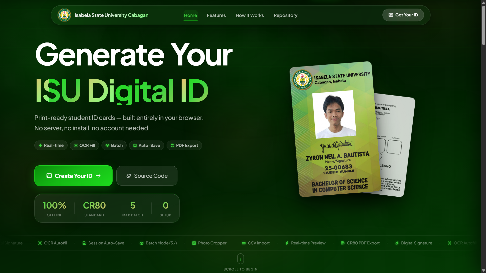
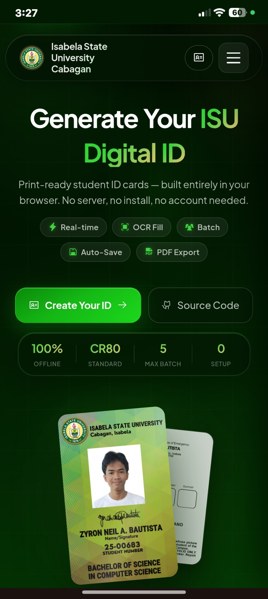

# 🎓 Isabela State University Premium ID Generator v3.9.0

A premium, fully responsive **client-side** web application for generating high-fidelity, print-ready student identification cards for **all 11 Isabela State University (ISU) campuses**. Built with a stunning glassmorphism UI, interactive 3D card preview, multi-campus theme engine, security hologram overlays, real-time QR verification, and a powerful batch export studio — no backend, no build tools, runs entirely in the browser.

🔗 **Live Demo Git Page**: [https://zyronneil2007.github.io/Isabela-State-University_Cabagan/](https://zyronneil2007.github.io/Isabela-State-University_Cabagan/)<br>
🔗 **Live Demo (Vercel)**: [https://isuid.vercel.app/web/](https://isuid.vercel.app/web/)<br>
🔗 **Live Demo (Netlify)**: [idgenratorisuc.netlify.app](https://idgenratorisuc.netlify.app)

---

## 📸 Screenshots & Demo

> A visual walkthrough of the application's key interfaces and interactive components.

| Desktop Hero | Mobile Hero |
|---|---|
|  |  |

| Feature | Preview |
|---|---|
| **3D Card Tilt & VanillaTilt Hover** |  |
| **Bento Grid Feature UI** |  |
| **Glassmorphic Batch Data Manager** |  |

> 💡 **Tip:** Replace the placeholder links above with actual GIF/screenshot URLs after recording your demo. Tools like [LICEcap](https://www.cockos.com/licecap/) or [ScreenToGif](https://www.screentogif.com/) are recommended for capturing the 3D tilt animation.

---

## ✨ Features

### 🆕 v3.6 — University Multi-Campus & Security Studio Edition
- **🏛️ All 11 ISU Campus Themes**: Instant theme switching across all 11 ISU campuses (Cabagan, Echague, Cauayan, Ilagan, Roxas, Angadanan, San Mateo, Jones, Palanan, San Mariano, Santiago City). Propagates accent colors to UI buttons, live canvas graphics, and WebGL Three.js hero particles.
- **📱 Real-Time Verification QR Code**: Renders a dynamic, scannable QR Code (`ISU-VERIFY:[ID]:[NAME]`) on the card back for instant campus gate verification.
- **🛡️ Holographic Security Watermark**: Interactive toggle for ISU Seal watermark, UV guilloche security curves, and iridescent ribbon sheen reflection.
- **📊 Glassmorphic Batch Data Manager**: Table modal with student photo/signature completeness badges, real-time search, batch deletion, and CSV re-export.
- **🔍 High-Res 3D Card Inspector Studio**: Full-screen 300 DPI canvas inspection modal for front and back faces.
- **🔊 Web Audio API Sound FX**: Native Web Audio API sound cues for card flips, tab switching, and batch export chimes with an instant mute toggle.

### 🆕 v3.5 — Bento Grid & Spatial Motion Overhaul
- **🎨 Immersive Spatial Redesign**: Split-screen hero layout, animated 6-card Bento Grid for features, and a guided 3-step process.
- **🚀 Advanced GSAP & Three.js Animations**: Particle constellation background in the hero section and holographic shimmer effects on the live card stage.

### 🆕 v3.4 — Session Auto-Save & OCR Autofill
- **💾 Auto-Save Session**: Auto-saves your entire session (all students, form data, photos, signatures) to `localStorage` after every change.
- **🔍 OCR Autofill from Photo**: Snap or upload a photo of any printed ID or registration form. Powered by **Tesseract.js** (offline WASM), extracts Name, ID Number, Course, and DOB automatically.

### 🆕 v3.3 — Local Signature Scanner & Extractor
- **🪄 Local Signature Extraction (No APIs)**: Otsu binarization and automatic bounding-box cropping strip paper shadows and convert handwritten paper signatures to clean, transparent ink.

### 🆕 v3.2 — CSV Bulk Import & Unlimited Batches
- **📥 CSV Bulk Student Import**: Upload a `.csv` file containing 50+ students to auto-generate all ID cards in one click with smart header mapping.

### 🆕 v3.1 — Native A4 Landscape PDF Export
- **📄 Native A4 Landscape PDF Export**: Arranges up to 5 student pairs (10 cards total) per sheet in side-by-side front/back stacked rows for easy double-sided printing.

---

## 🛠️ Tech Stack

| Layer | Technology |
|---|---|
| Structure | Semantic HTML5 (ARIA roles, keyboard navigation) |
| Styling | Vanilla CSS3 (custom properties, GPU transforms, glassmorphism) |
| Logic | Vanilla ES6+ JavaScript as native ES modules (Canvas API, jsPDF, FileReader) |
| 3D / Graphics | [Three.js r134](https://threejs.org/), [VanillaTilt.js](https://micku7zu.github.io/vanilla-tilt.js/) |
| Animations | [GSAP 3](https://greensock.com/gsap/) + ScrollTrigger, [Anime.js v4](https://animejs.com/) |
| OCR | [Tesseract.js v5](https://tesseract.projectnaptha.com/) (offline WASM) |
| Icons & Fonts | [Phosphor Icons](https://phosphoricons.com/), Google Fonts (Plus Jakarta Sans, Roboto Condensed) |

---

## 📂 Project Structure

```text
Isabela-State-University_Cabagan/
├── web/                         # Client-side web app (this folder is what GitHub Pages serves)
│   ├── index.html               # Entry point (stylesheet <link>s in cascade order, module scripts)
│   ├── sw.js · manifest.webmanifest   # PWA
│   ├── src/                     # ES modules, one folder per feature
│   │   ├── app.js               #   entry — imports every module
│   │   ├── core/                #   config (card coordinates), state, boot, inline-handler bridge
│   │   ├── features/            #   id-generator · card-preview · student-management · photo-editor
│   │   │                        #   signature · csv-import · ocr · batch-manager · qr-verification · campus-theme
│   │   ├── services/            #   storage (session) · export (PDF/PNG) · image-processing
│   │   ├── animations/          #   GSAP / Anime.js / holographic effects
│   │   └── utils/               #   toast, throttle
│   ├── styles/                  # CSS split by layer: base · layout · components · features · responsive
│   ├── assets/                  # images/{logos,templates/{legacy,2026},placeholders,screenshots} · fonts/
│   └── tools/                   # dev-only Python scripts: dummy_data_generator.py · photo_resizer.py
│
├── android/                     # Kotlin + Jetpack Compose + WebView shell
│   └── app/src/main/assets/www/ #   generated copy of web/ — run scripts/sync-android-assets
├── docs/                        # architecture · design · development · deployment · security · decisions
├── scripts/                     # validation/ (tests, linters) · sync-android-assets/
├── .github/                     # CI workflows, issue & PR templates
├── wiki/                        # GitHub wiki sources
└── README · CHANGELOG · CONTRIBUTING · SECURITY · AGENTS · LICENSE
```

Details: [`docs/architecture/ARCHITECTURE.md`](docs/architecture/ARCHITECTURE.md) · migration notes: [`docs/development/MIGRATION_GUIDE.md`](docs/development/MIGRATION_GUIDE.md).

---

## 🚀 Getting Started

### ✅ Prerequisites

- **Modern web browser** — Chrome 90+, Firefox 88+, Edge 90+ or Safari 15+.
- **A static HTTP server** — **required**: the app uses native ES modules, which browsers will not load from `file://` (double-clicking `index.html` shows a blank page). Use either:
  - `python3 -m http.server` (Python 3.x), or
  - `npx serve` (Node.js 16+).
- **Android Studio** *(Android only)* — Arctic Fox or later, SDK targeting API 24+.
- **Python 3.x** *(optional)* — for `web/tools/` (dummy data generator, photo resizer).
- **Node.js + Playwright / ESLint** *(optional, contributors only)* — for `scripts/validation/`. The app itself has no build step.

### 🌐 Web Application (local development)
```bash
git clone https://github.com/ZyronNeil2007/Isabela-State-University_Cabagan.git
cd Isabela-State-University_Cabagan/web
python3 -m http.server 8000      # or: npx serve .
```
Open <http://localhost:8000>. Edit files and refresh — there is no build step. Deployed copies (GitHub Pages) work out of the box.

### 📱 Android Application
1. Run `node scripts/sync-android-assets/sync.js` to refresh the bundled web assets (only needed after changing `web/`).
2. Open the `android/` directory in Android Studio, sync Gradle and run on a device/emulator (Android 7.0+ / API 24+).

### ✅ Checks before a PR
```bash
node scripts/validation/check-references.js
NODE_PATH=$(npm root -g) node scripts/validation/regression.js     # npm i -g playwright
NODE_PATH=$(npm root -g) node scripts/validation/features.js
node scripts/sync-android-assets/sync.js --check
```

---

## 📖 Quick Start Guide

### 🔍 Using OCR Autofill

Automatically populate the student form from a photo of any printed ID or registration slip in 3 steps:

1. **Upload the Source Document** — In the student form, click the **"OCR Autofill"** button and select (or snap) a photo of the printed ID card or enrollment form. Supported formats: JPEG, PNG, WEBP.
2. **Tesseract.js Scans Offline** — The app runs Tesseract.js v5 entirely in-browser via WebAssembly. No data is transmitted to any server. A progress indicator displays the recognition confidence in real time.
3. **Review, Edit & Apply** — The extracted fields (Name, ID Number, Course, Date of Birth) are displayed in a review panel *before* being committed to the form. Correct any OCR errors, then click **"Apply to Form"** to auto-fill all matched fields instantly.

> **Note:** OCR accuracy is significantly improved with high-contrast, well-lit photos. Avoid glare, shadows, and extreme angles when capturing the source document.

---

### 🖨️ Printing Tips

> [!IMPORTANT]
> **For best print results on A4 PDF exports, follow these settings:**
>
> - **Scale**: Set your printer's page scaling to **"Actual Size" (100%)** — never "Fit to Page", as this will shrink the CR80 card dimensions below the 85.6 × 54 mm standard.
> - **Double-Sided Printing**: Enable **"Flip on Long Edge"** (portrait duplex) in your printer's settings to correctly align front and back faces when cutting.
> - **Paper**: Use **160–200 gsm matte or glossy cardstock** for a premium, durable finish closest to the CR80 PVC standard.
> - **Cut Guides**: The exported PDF includes dashed cut-guide lines at exact CR80 boundaries — use a guillotine paper cutter for clean, precise edges.

---

## 📋 Changelog

See [CHANGELOG.md](CHANGELOG.md) for the full release history.

---

## 🤝 Contributing

Contributions, bug reports, and feature suggestions are warmly welcome from fellow developers and ISU community members. Here's how to get involved:

1. **Fork the repository** — Click **Fork** at the top of the [GitHub repo](https://github.com/ZyronNeil2007/Isabela-State-University_Cabagan) to create your own copy.
2. **Create a feature branch** — Use a descriptive branch name that reflects your change:
   ```bash
   git checkout -b feat/your-feature-name
   ```
3. **Make your changes** — Follow the existing code style. Keep commits atomic and write clear, imperative commit messages (e.g., `feat: add Echague campus theme override`).
4. **Test across browsers** — Verify your changes in at least Chrome and Firefox before submitting.
5. **Open a Pull Request** — Push your branch and open a PR against `main`. Provide a clear description of *what* you changed and *why*. Reference any related issue numbers.
6. **Report Bugs** — Use the [GitHub Issues](https://github.com/ZyronNeil2007/Isabela-State-University_Cabagan/issues) tracker. Include your browser version, OS, and steps to reproduce the issue.

> [!NOTE]
> This project has no build step — all source files are plain HTML, CSS and JavaScript (ES modules). Serve `web/` with any static server (see *Getting Started*) and refresh to test changes. See [CONTRIBUTING.md](CONTRIBUTING.md).

---

## 📬 Contact

Created, designed, and developed by **Zyron Neil**.

| Platform | Link |
|---|---|
| 🐙 GitHub | [github.com/ZyronNeil2007](https://github.com/ZyronNeil2007) |
| 💼 LinkedIn | [www.linkedin.com/in/neil-bautista-8656b4362](www.linkedin.com/in/neil-bautista-8656b4362) |
| 🌐 Portfolio | [your-portfolio.dev](https://your-portfolio.dev)|

Feel free to reach out for collaborations, campus deployment inquiries, or feature requests specific to ISU academic workflows.

---

## 🧑‍💻 Credits & License

Created, designed, and developed by **Zyron Neil**.

---
© 2026 Zyron Neil. All rights reserved.
